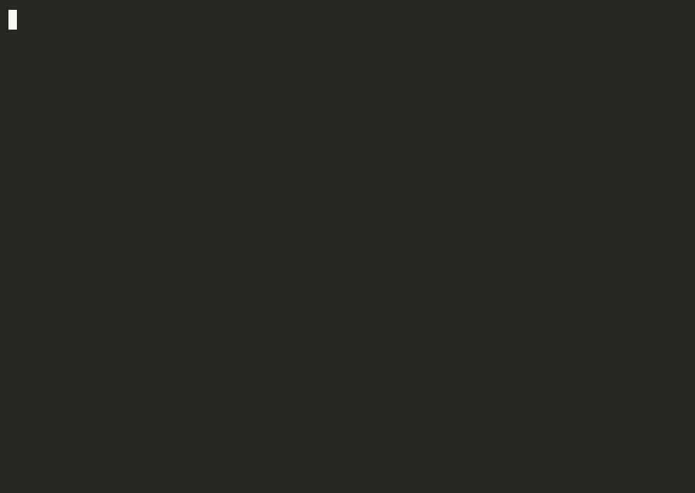
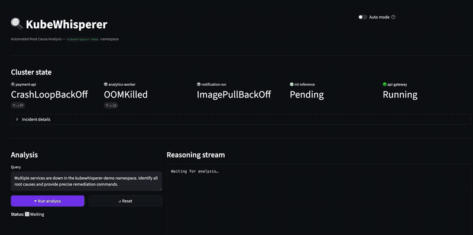

# KubeVerdict

**An RCA assistant for Kubernetes that tells a configuration drift from a symptom, and publishes how often it names the right cause.**

For the on-call SRE or platform engineer running workloads with Helm (GitOps optional). KubeVerdict compares what a release declares with what actually runs, collects Kubernetes, Helm and observability evidence into one graph, and proposes a root cause and a fix with its rollback. Then it stops at a human gate: it never changes the cluster on its own.

[](https://github.com/a1h8/kube-verdict/actions/workflows/ci.yml)
[](https://www.python.org)
[](LICENSE)



### Try it in 2 minutes — offline, no cluster, no Ollama

```bash
git clone https://github.com/a1h8/kube-verdict && cd kube-verdict
make demo
```

`make demo` runs a **real** render-vs-live RCA on a committed fixture (`h012`): it diffs the `helm template` expected state against the observed cluster and ranks the root cause — the same code that runs in CI (`tests/integration/test_render_vs_live_h012.py`). No mocks.

📺 **[▶ Watch the 35-second demo](demo/kubeverdict-short.mp4)** — incident → evidence → verdict → human gate.

---

## Status — measured, not claimed

How often KubeVerdict names the right cause, on what, and how it was measured. Every number links to its records.

| Measurement | Result | How |
|---|---|---|
| Offline, real model — mistral 7B via Ollama, no retrieval | **invalidated — re-measure in progress** | the model read only ~17 % of each prompt: Ollama's default 2048-token context cut the evidence and kept the end. The recorded 28/54 measures the prompt's tail, not the diagnosis ([case-audit-001.md](docs/case-audit-001.md) F8) |
| Offline, rules alone (no LLM) | **3/18** | same cases, top deterministic hypothesis ([REPORT.md](tests/veracity/replay/REPORT.md)) |
| Live, real cluster | **not measured yet** | the two live captures of 2026-09-26 (0/2) do not count: the scenarios were staged — the pod failed on a closed probe port while the "cause" was only printed text ([case-audit-001.md](docs/case-audit-001.md) F3) |

What these numbers say, and do not say:

- **Rules alone find 3/18.** What the LLM adds is not known yet: it has not been measured on the whole prompt.
- **It does not say "I don't know" yet.** On a healthy cluster (h022) the model invented a cause 3/3 times and answered MEDIUM on 53/54 runs, under the truncated prompt; part of the cause is in the pipeline: a restart from hours ago makes the healthy pod a starting point. The rules alone do abstain.
- **18 cases are not a general accuracy.** They are prepared scenarios with a known cause; incidents we did not write are not measured yet. An audit of the 18 found 8 to correct or retire ([case-audit-001.md](docs/case-audit-001.md)); the numbers will be re-measured on the corrected cases.

## Why it matters

Most Kubernetes outages are not caused by a single failing pod.

When payment-service crashes, the on-call engineer opens five tabs simultaneously: pod logs, Kubernetes events, Helm history, Prometheus graphs, and the GitOps repo. Under pressure, at 2 AM, with three Slack threads open. The root cause is rarely where the alert fired — it's three hops away in a misconfigured Helm value or a drift between what was declared and what actually runs.

## What it does differently: a drift is not a symptom

Most RCA tools start from live symptoms: events, logs, metrics and alerts. KubeVerdict also starts from **intent**: it reconstructs what *should* be running from the Helm release (and, when configured, from the rendered GitOps manifests: [anchor-by-render](docs/anchor-by-render.md)), compares it with the live cluster, and keeps two kinds of gap apart:

- **Configuration drift** — the live object differs from what the release declares (`spec.replicas` vs `replicaCount`, an image tag, a memory limit, a probe timeout). It is a cause candidate (`drift.*`).
- **Symptom** — the workload is unhealthy (`readyReplicas: 0`, `CrashLoopBackOff`, restarts). It is evidence that something is wrong, not a cause (`health.*`).

A bad value that is *declared* is not a drift either: the cluster matches the release, and the cause is the value itself.

## Evidence sources, and how far each is proven

| Evidence source | Status |
|---|---|
| Helm configuration drift (declared vs live) | **tested offline** on the native cases that carry one (h002, h003, h009, h016, h024); runtime status kept apart as a symptom |
| Kubernetes events / runtime state | **tested offline**, collected live |
| Rendered Helm/GitOps manifests (expected state) | **opt-in** (`GITOPS_REPO_URL`); one fixture case (h012); no GitOps controller tested live yet |
| Prometheus alerts, Loki logs, OTel traces | **tested offline** through the real collectors (h013–h015); reached live once each (2026-09-26, [evidence](docs/evidence/prometheus-live.md)); those live scenarios were staged, so the runs prove the collectors, not the diagnosis |
| Resolved-incident memory (past human-approved fixes) | **wired** — `knowledge/example_store.py`, indexed into FAISS; its effect on accuracy is not measured yet |
| Policy reports (Kyverno / OPA `PolicyReport`) | **wired** — ingested as `PolicyViolation` evidence |
| Enterprise docs / runbooks / SOPs | **pluggable** — `knowledge/doc_indexer.py`; no corpus ships by default |

## Out of scope, on purpose

- **No autonomous remediation.** Every fix goes through human approval; the blast radius is a heuristic over the proposed command, not a guarantee.
- **Single cluster.** Multi-cluster is not wired.
- **No incident prediction.** Temporal anomaly scores (PatchTST) are a supporting signal; offline they run on synthetic series and add no evidence.

## Experimental — kept, not measured as contributing

The Monte Carlo stability check (it feeds the policy gate), beam-search path switching and the PatchTST detector are part of the workflow, but their contribution to the right answer has not been measured. A layer-by-layer comparison is the next measurement.

## Two modes: local (air-gapped) or hosted

| Mode | Model | What leaves the cluster | Measured |
|---|---|---|---|
| **Local / air-gapped** (default) | Ollama + mistral on your hardware; the embedding model (`all-MiniLM-L6-v2`) from a pre-seeded cache (see [Air-gapped clusters](#air-gapped-clusters)) | nothing | the numbers in [Status](#status--measured-not-claimed); 127 s median per case on 8 CPU cores, no GPU (61–332 s) |
| **Hosted** | Groq, Anthropic, OpenAI or Google (`LLM_PROVIDER` + API key) | the evidence sent to the model: object names, events, log lines | not measured yet |

The hosted mode is there for hardware that cannot run a local model fast enough. The replay (`tools/veracity_replay.py`) drives Ollama only today; measuring the hosted mode on the same cases needs it to accept the other providers. Dependencies are not pinned yet.

---

## Try without a cluster

The **Integration Tests** tab runs entirely offline — no cluster, no Ollama needed:

1. `streamlit run ui/app.py`
2. Go to **🧪 Integration Tests**
3. Select any `h00N_*` case from the dropdown
4. Mode defaults to **🔬 Pipeline trace** — pipeline runs automatically
5. Explore all 10 steps: tokenizer → retrieval → anchors → drift → confidence → proposed fixes

---

## Demo

### Browser UI — no cluster required



```bash
bash demo/kap_record_ui.sh       # starts Streamlit, opens browser
```

---

### CLI — live k3d cluster, end-to-end loop


Full loop on a real cluster: Alertmanager alert → RCA in 7s → human approval → cluster heals.

```
Alertmanager fires KubePodCrashLooping
        ↓  202 Accepted, session created
KubeVerdict ingests live K8s events
        ↓  7s
Root cause: "dial tcp db-primary:5432: connection refused — database initialisation failed"
Confidence: MEDIUM  ·  Blast radius: 5 resources
        ↓  human gate
Approve remediation? [y/N]  →  y
        ↓
db-primary deployed  ·  payment-service reconnected  ·  analytics-worker healed
All pods Running ✓
```

```bash
bash demo/kap_record.sh          # reset → baseline → start API
bash demo/cluster_setup.sh --inject
python demo/demo_webhook.py      # alert → RCA → approve → fix
```

---

### Advanced decision walkthrough — thresholds, dead-ends & the human gate

A 78-second walkthrough of the decision engine on a real incident: a strict
threshold rejects a low-confidence path, KubeVerdict backtracks, a lenient
profile finds a valid remediation, and execution stops at the human gate.

▶ [Watch the decision walkthrough (78s, MP4)](demo-decision-thresholds.mp4) · subtitles burned in

More: [general demo](demo/kubeverdict-demo.mp4) · [FAQ — “why not just kubectl?”](demo/kubeverdict-faq.mp4)

<sub>Synthetic voice + subtitles. No personal identity attached.</sub>

→ [Full demo guide](docs/demo.md)

---

## Safety model

Every remediation command goes through two gates before execution:

1. **Human approval** — the SRE reviews evidence, root cause and proposed fix before anything is applied
2. **Rollback plan** — KubeVerdict generates the inverse command (`helm rollback`, `kubectl rollout undo`) alongside every fix proposal

A **blast-radius estimate** (LOW / MEDIUM / HIGH / CRITICAL) accompanies each proposal. It is currently a heuristic over the *proposed command* — it parses the kubectl/helm verb, namespace, resource kind, cluster-scope and affected-resource count. It is **not yet** a rendered-vs-live diff of the resources that would actually change; treat it as a triage signal, not a guarantee of impact.

Nothing touches the cluster without explicit sign-off. Autonomous execution is not implemented by design.

---

## How it works

The LLM is constrained by retrieved evidence. KubeVerdict ranks hypotheses from deterministic signals first — ontology topology, anchor violations, drift, policies and resolved incidents — then uses the LLM only to produce an evidence-grounded RCA.

**Evidence assembly** — runtime *and* enterprise inputs feed the same graph:

```
  RUNTIME (live cluster)              ENTERPRISE CONTEXT
  ───────────────────────             ───────────────────────────────────────
  Kubernetes state / events           Enterprise Helm charts ─► rendered manifests   (opt-in)
  logs / metrics                      Enterprise docs / runbooks / SOPs              (pluggable)
                                      Kyverno / OPA policy reports                   (wired)
                                      Resolved-incident memory                       (populated)
            │                                          │
            └───────────────► merged into ◄────────────┘
                          │
        Declared-vs-observed drift  +  typed evidence anchors
                          │
        OntologyGraph  (typed entities + relationships)
                          │
        BM25 + FAISS + RRF hybrid retrieval
                          │
        Evidence-weighted hypothesis ranking
```

**Then a decision engine — not a one-shot RCA.** The ranked hypotheses feed a LangGraph state
machine that runs in two phases joined by one conditional edge:

```
analyze ⟲ confidence router  →  converge  →  blast radius · Monte Carlo · policy verdict  →  human gate ⟲
```

Two consecutive LOW results archive a path and re-rank the remaining candidates (beam search). On
convergence the solution is gated — blast-radius estimate → Monte Carlo stability → policy verdict
(**AUTO / HUMAN_REVIEW / NO_GO**). Production always routes to a human gate (current: break-glass ·
target: PR/MR-first); the gate is a LangGraph interrupt, so the operator can approve, reject, or
inject extra context that re-runs the analysis. Approved fixes are remembered and short-circuit
identical future incidents.

→ Full two-phase node/edge diagram in
[architecture.md](docs/architecture.md#two-phase-decision-graph).

---

## Validated scenarios

Ten failure patterns reproduced end-to-end in CI as offline fixtures — no cluster, no Ollama required.

| Scenario | Case | What it proves |
|---|---|---|
| CrashLoopBackOff — missing dependency | h001 | BFS graph traversal, BM25+FAISS retrieval, anchor detection, confidence scoring, fix proposals |
| ImagePullBackOff — registry auth / tag drift | h002 | Helm drift detection, `drift.*` annotations, image proposal generation |
| OOMKilled — memory limit drift | h003 | Helm declared-vs-observed diff, `anchor_fix_hints()` → `helm upgrade --set` |
| Missing ConfigMap / Secret at pod start | h004 | `DeploymentReadinessDetector`, `missing.*` annotations, `kubectl create` hints |
| RBAC — missing ClusterRoleBinding | h005 | SA exists but no binding detected, `kubectl create clusterrolebinding` hint |
| NetworkPolicy egress block | h006 | `netpol.*` annotations, `kubectl edit networkpolicy` hints |
| HPA cannot scale — metrics-server unavailable | h007 | HPA target resolution, metrics-unavailable detection, `metrics-server` fix hints |
| Init container failing — DB migration exits 1 | h008 | `Init:0/1` detection, init-container log correlation, root-cause on migration failure |
| Liveness probe too aggressive — kills healthy pods | h009 | probe-timeout drift (`timeoutSeconds` declared vs deployed) → `helm upgrade` fix |
| ResourceQuota exceeded — pod stuck Pending | h010 | `ResourceQuota` entity, namespace quota correlation, pending-pod root cause |
| GitOps render-vs-live drift — OOMKilled (fixture) | h012 | `helm template` expected state diffed vs live cluster (replicas 3→1, memory 512Mi→128Mi); `oom_kill` ranked H1 |

Cases h001–h010 each have a `test_hybrid_pipeline_NNN.py` running the full pre-LLM pipeline: graph construction → hybrid retrieval (BM25 + FAISS + RRF) → context building → anchor/drift/policy scoring → proposal generation. A further case — **h011 (StatefulSet update stuck on a bound PVC)** — is wired in but not yet passing its confidence/resolvable-path assertions; it is a good first contribution.

**h012** (`test_render_vs_live_h012.py`) validates the **anchor-by-render** path: the expected state is reconstructed by rendering the chart with `helm template` (committed as evidence) and diffed against the observed cluster. The diff/ranking runs deterministically in CI with **no helm binary**; a helm-guarded check re-renders the chart to keep the committed golden faithful. It is a **fixture-based** scenario — it demonstrates the render-vs-live evidence flow, not production-grade telemetry.

**h013, h014 and h015** are the three *telemetry-only* cases — one per observability signal (metrics, logs, traces): Kubernetes status shows at most a symptom, never the cause, so the evidence comes purely from observability data, replayed from committed fixtures through the real collectors.
- **h013 — SLO error-budget burn** (`test_prometheus_fixture_h013.py`): a pod with 3/3 replicas Ready, zero restarts and no drift, while Prometheus fires multi-window burn-rate alerts (14.4× over 1h/5m, 6× over 6h/30m) and a p99/p95 latency-SLO breach isolated to one dependency. The alerts run through the **real** `PrometheusCollector` (only its HTTP fetch is swapped for the fixture), so a `pending` alert and an alert with no matching entity are dropped exactly as they would be live.
- **h014 — expired mTLS certificate** (`test_loki_fixture_h014.py`): a cert-manager issuer cannot renew, the certificate expires and both replicas fail readiness (Deployment 0/2). Events show the symptom (readiness 503) and an issuer warning but never name the expired certificate; only the pods' logs do (`x509: certificate has expired`). The log streams are served to the **real** `LokiSource`, which selects the pods because they are `Running` but not ready, and a same-named pod in another namespace is not returned.
- **h015 — etcd compaction latency** (`test_otel_fixture_h015.py`): a pod `Ready=False` on a readiness timeout whose cause appears only in OTel error traces (`DeadlineExceeded` on etcd `Range`). The traces are served to the **real** `OtelCollector` by a fixture backend, so the pod is picked by the same readiness-aware selection a live run uses (a `Running` pod that is not ready), and a trace for an unrelated service is dropped.

Both are validated at the **evidence-path level** — fixture → graph → context window, deterministic in CI, no cluster, no Ollama. They do not assert the LLM's root-cause wording (that needs a model and runs through the generic `test_native_helm_dialogue`). On live telemetry: Prometheus, Loki and OTel were each reached live on 2026-09-26 (`docs/evidence/prometheus-live.md`); those live scenarios were staged, so their two graded answers say nothing about the diagnosis — see [Status](#status--measured-not-claimed).

---

## Quick start

**Prerequisites:** Python 3.11+, a Kubernetes cluster reachable via kubeconfig, and one LLM provider configured in `.env`.

**Kubernetes versions:** KubeVerdict is *version-aware* — it detects the API server version at
startup and adapts API selection (Ingress, CronJob, HPA, PodSecurityPolicy) across Kubernetes
**1.19 → current**, and parses k3s/k3d version strings (`v1.28.3+k3s1`). See
[Multi-version Kubernetes](docs/architecture.md#multi-version-kubernetes).

```bash
git clone https://github.com/a1h8/kube-verdict.git
cd kube-verdict
pip install -r requirements.txt

cp .env.example .env
# Edit .env: KUBECONFIG, LLM_PROVIDER, KUBE_NAMESPACES
# LLM_PROVIDER=ollama  → ollama pull mistral  (local, no data leaves infra)
# LLM_PROVIDER=groq    → set GROQ_API_KEY     (fast, free tier)
# LLM_PROVIDER=anthropic|openai|google → set corresponding API key

streamlit run ui/app.py
```

---

## Interfaces

The same investigation is reachable through several surfaces:

- **REST API (FastAPI)** — the runtime the Docker image ships (`uvicorn api.app:app --port 8000`). Session lifecycle under `/api/v1/sessions` plus a one-call `POST /api/v1/investigate` that returns a stable verdict envelope (root cause, confidence, blast radius, policy verdict, remediation). Optional shared-secret bearer guard via `KUBEVERDICT_API_TOKEN` (not OIDC). See [REST API](docs/api.md).
- **Streamlit demo** — `streamlit run ui/app.py`; the offline pipeline-trace explorer described above.
- **Decision Journey (React dashboard)** — `npm --prefix dashboard run dev`, then open `…/#/journey`. Renders the decision *process* from the API: verdict, explored / eliminated hypothesis paths, and the decision timeline. Click **Load sample** to see a full journey with no cluster or Ollama.
- **MCP / Agent Skills** — `kube_rca`, `helm_drift`, `expected_state_drift`, `blast_radius` (see below).

---

## Documentation

| Document | Content |
|---|---|
| [Anchor-by-render](docs/anchor-by-render.md) | The core concept: rendered Helm/GitOps intent as the evidence anchor, drift-as-evidence, honest status |
| [Architecture](docs/architecture.md) | Full pipeline diagram, LangGraph workflow, evidence-first hypothesis generation, anchor system design, drift detection |
| [REST API](docs/api.md) | FastAPI endpoints, session lifecycle, request/response examples, SSE stream |
| [UI reference](docs/ui.md) | Streamlit tabs, pipeline trace steps, anchor pivot table, reasoning journey, router decisions |
| [Test cases](docs/test-cases.md) | h001–h010 validated scenarios, case format, adding a new case, CI coverage |
| [Project layout](docs/project-layout.md) | Full directory tree, RBAC |
| [Roadmap](docs/roadmap.md) | Done and next |
| [Configuration](docs/configuration.md) | All `.env` variables, hybrid retrieval tuning, source weights |
| [Deployment](docs/deployment.md) | Docker, k3d, production K8s |

---

## Agent Skills / MCP integration

KubeVerdict exposes `kube_rca`, `helm_drift`, `expected_state_drift`, and `blast_radius` as MCP tools consumable by any MCP-compatible client (Claude Desktop, Cursor, Continue). `expected_state_drift` is deployment-mode agnostic — it diffs a pushed expected-state source (Helm / Helmfile / Kustomize / raw manifests) at a pinned version against the live cluster.

### Install the skill (skills.sh)

```bash
npx skills add a1h8/kube-verdict
```

This installs the KubeVerdict **skill definition** (`SKILL.md`) into any agent (Claude Code, Codex,
Cursor, Gemini CLI, …) so it knows when and how to invoke the tools. The tools themselves
(`kube_rca`, `helm_drift`, `expected_state_drift`, `blast_radius`) are served by the MCP server, so
you still run the one-time MCP setup below (Python 3.11+ env and, for air-gapped use, Ollama).

### Claude Desktop

```json
{
  "mcpServers": {
    "kube-verdict": {
      "command": "python",
      "args": ["mcp_server.py"],
      "cwd": "/path/to/kube-verdict"
    }
  }
}
```

### Cursor

Add to `.cursor/mcp.json` in your project root:

```json
{
  "mcpServers": {
    "kube-verdict": {
      "command": "python",
      "args": ["mcp_server.py"],
      "cwd": "/path/to/kube-verdict"
    }
  }
}
```

### Codex

`npx skills add a1h8/kube-verdict` installs the skill for Codex as well. A first-class Codex plugin
manifest ships in `.codex-plugin/` (skill + `interface` metadata). As with the other clients, the
tools are served by the MCP server, which you register in `~/.codex/config.toml`:

```toml
[mcp_servers.kube-verdict]
command = "python"
args = ["mcp_server.py"]
cwd = "/path/to/kube-verdict"
```

### Air-gapped clusters

All three tools run fully offline — Ollama + Mistral, no data leaves your infrastructure:

```bash
ollama serve &          # local LLM on port 11434
python mcp_server.py    # MCP stdio server, reads kubeconfig from env
```

**Embedding model:** the container image does not bake in the `all-MiniLM-L6-v2`
sentence-transformer (~90 MB) — it is fetched on first use. For a sealed
air-gapped deployment, pre-seed it once on a connected machine and mount the
cache into the container at `/app/.cache/huggingface`:

```bash
# on a connected machine — populates ~/.cache/huggingface
python -c "from sentence_transformers import SentenceTransformer; SentenceTransformer('all-MiniLM-L6-v2')"
# then mount that dir at /app/.cache/huggingface (k8s: a PVC or hostPath volume)
```

See [SKILL.md](SKILL.md) for the full tool reference and air-gapped RBAC setup.

### OpenAI-compatible schema

The tool schema is also available in OpenAI function-calling format at [`openapi_tools.json`](openapi_tools.json),
compatible with any SDK that supports the function-calling API (OpenAI, LangChain, LlamaIndex).
It is generated from the MCP tool definitions — regenerate after changing a tool with:

```bash
python tools/gen_openapi_tools.py        # rewrite openapi_tools.json
python tools/gen_openapi_tools.py --check # CI guard: fail if stale
```

Feed `openapi_tools.json` as the `tools` array to any function-calling LLM, then
execute the model's tool calls against the same handlers the MCP server uses:

```python
from mcp_server import dispatch_openai_tool_call

for call in response.choices[0].message.tool_calls:
    tool_message = await dispatch_openai_tool_call(call.model_dump())
    messages.append(tool_message)   # role=tool, ready for the next turn
```

---

## Temporal evidence (PatchTST)

KubeVerdict treats PatchTST as a **supporting temporal-evidence layer, not the root-cause engine. It does not predict incidents.**

The temporal detector (`signals/patchtst_detector.py`) can produce forecast residuals, reconstruction errors, z-score fallbacks and regime-transition signals. These **strengthen or weaken** RCA hypotheses already grounded in GitOps intent, rendered manifests, Kubernetes runtime evidence, policy violations and incident memory.

**Status — experimental.** When Prometheus is absent the analyzer falls back to synthetic / fixture-based history, and short signals fall back to a z-score. These scenarios illustrate the evidence flow; they are **not production-grade incident prediction** until real Prometheus-backed telemetry is connected and validated. Treat temporal anomaly scores as a supporting signal, not validated evidence.

> Read it as *"PatchTST provides temporal evidence that strengthens or weakens KubeVerdict RCA hypotheses"* — **not** *"KubeVerdict predicts incidents with PatchTST."*

**Attribution.** The PatchTST model is consumed via the HuggingFace [`transformers`](https://github.com/huggingface/transformers) implementation of *"A Time Series is Worth 64 Words: Long-term Forecasting with Transformers"* (Nie et al., ICLR 2023) — original implementation: [yuqinie98/PatchTST](https://github.com/yuqinie98/PatchTST) (Apache-2.0). KubeVerdict vendors no PatchTST source; `signals/patchtst_detector.py` is an original detector built on the library model. Temporal evidence is developed independently in [a1h8/temporal-evidence-engine](https://github.com/a1h8/temporal-evidence-engine), which uses PatchTST as a model backend.

---

## Current limitations

Several constraints are intentional or known:

- **Scenarios h001–h010 are reproduced in CI with a scripted LLM**, which checks the evidence path, not the diagnosis; the real-model numbers are in [Status](#status--measured-not-claimed) (h011 is wired in but not yet passing). Advanced scenarios on the roadmap — Helmfile multi-release, MCTS routing, Slack/PagerDuty enrichment, RBAC-aware (impersonated) scoping — are not yet implemented.
- **Single-cluster.** Multi-cluster support is not yet wired end-to-end.
- **No auto-remediation in production.** The human approval gate is by design; autonomous execution is not implemented.
- **LLM performance is local-hardware-dependent.** Mistral via Ollama requires at least 8 GB RAM; a GPU significantly accelerates inference.
- **Primary validated inputs: Kubernetes events and Helm drift.** Prometheus, Loki, and OTel collectors exist and are wired in, but the E2E demo and validated test cases currently focus on the K8s events + Helm drift path.
- **Temporal anomaly detection (PatchTST) is experimental** and a *supporting* signal only — see [Temporal evidence (PatchTST)](#temporal-evidence-patchtst). Until it runs on real Prometheus series it falls back to synthetic/fixture history and z-scores; it is not validated evidence and does not predict incidents.

See [Roadmap](docs/roadmap.md) for what's next.

---

## Contributing

Contributions are welcome — especially:

- New failure scenario cases (`tests/integration/cases/h0NN_*` format — see [Test cases](docs/test-cases.md))
- Signal-driven test cases that exercise the Prometheus, OTel, or Loki collector paths end-to-end
- LLM provider integrations

See [Project layout](docs/project-layout.md) for the codebase structure.

---

## Community

KubeVerdict is open-source and focused on Kubernetes incident investigation.
Feedback, reproducible failure scenarios and integrations are welcome — open an issue or start a discussion.

---

## License

[Apache 2.0](LICENSE)